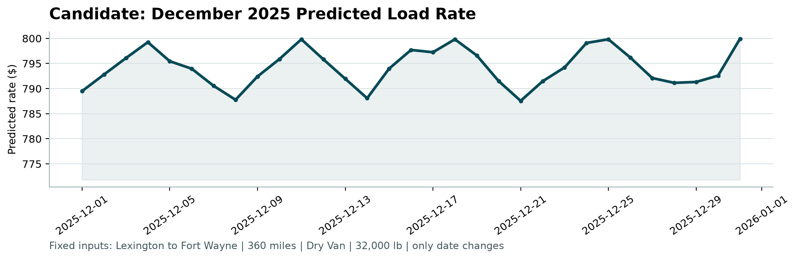

# Freight Rate Prediction — Report

## Approach

One reproducible pipeline (`train.py`) cleans the data, builds features, validates on
time-based splits, fits a gradient-boosted model, and writes both prediction files.

**Model:** `HistGradientBoostingRegressor` (scikit-learn), chosen because it handles
missing values and the categorical `equipment` feature natively — no imputation or
one-hot encoding to get wrong. scikit-learn is the only new dependency.

**Target:** `log(posted_rate / distance)` — log rate-per-mile. Distance dominates the
rate (correlation 0.91), so modeling per-mile pricing keeps the target stable across
short and long trips. Predictions are converted back with `exp(pred) * distance`.

**Features:** road distance, haversine straight-line distance and their ratio; pickup
and delivery coordinates and their deltas (coordinates, not city names, so the 8
validation-only cities still work); equipment (categorical); weight, market_index,
quote_signal; day of week. Month and day-of-year are deliberately excluded:
November–December never appear in training, so the model would extrapolate blind —
`market_index` already carries the seasonal signal.

## Data-quality issues and fixes

| Issue | Fix |
|---|---|
| 292 negative weights (train; 145 in validation), magnitudes in the normal range | `abs()` — sign flip |
| 22 road distances (train; 16 in validation) > 2x the straight-line distance (worst 9.6x; ~1.18x is normal) | **kept as-is** — all are nearby city pairs listed at exactly 70 mi (a minimum-distance floor), and their rates match the listed distance (~$3/mi, normal for short hauls) |
| ~1.2% rate-per-mile outliers (< $1.0 or > $6.0; normal band ~1.7–3.2) — two clusters around $0.6–0.9 and $8–14/mi, likely unit or entry errors | dropped from **training only** (599 rows); kept in prediction data |
| Missing `weight` (~300), `market_index` (~374) | left as NaN — the model handles them natively |
| `december_chart_inputs.csv` missing coordinates, `market_index`, `quote_signal` | coordinates looked up from Lexington/Fort Wayne training rows; daily `market_index`/`quote_signal` filled with per-day means of validation.csv's December rows |

## Validation approach

Random splits leak: this is a forecasting task (train Jan–Oct, predict Nov–Dec), so
all validation is time-based.

- **Main holdout:** train Jan–Aug, test Sep–Oct — two future months after a gap-free
  cutoff, exactly like the real task. A small manual sweep over `learning_rate`,
  `max_iter`, `max_leaf_nodes` picked `learning_rate=0.05, max_iter=200,
  max_leaf_nodes=63`.
- **Expanding window:** train through month M, test month M+1 (M = Jun–Sep), showing
  stability across cutoffs.
- **Unseen-city check:** 8 cities (Bakersfield, Hartford, Memphis, New York,
  San Antonio, Toledo, Tulsa, Washington) held out entirely; error stays low,
  confirming the coordinate features generalize to new cities.
- **Baseline:** median rate-per-mile by equipment x distance.

## Metrics (rate in $)

| experiment | MAE | MAPE % | RMSE | baseline MAE | baseline MAPE % | baseline RMSE |
|---|---|---|---|---|---|---|
| holdout Sep–Oct | 81.44 | 3.06 | 261.99 | 183.50 | 8.19 | 342.76 |
| holdout Sep–Oct incl. outliers | 128.06 | 5.39 | 639.54 | 229.22 | 10.49 | 670.73 |
| expand Jan–06 → 07 | 45.41 | 1.68 | 215.35 | 163.98 | 7.87 | 297.51 |
| expand Jan–07 → 08 | 114.35 | 5.49 | 244.24 | 200.29 | 8.34 | 347.27 |
| expand Jan–08 → 09 | 85.89 | 3.25 | 233.18 | 185.37 | 8.19 | 323.04 |
| expand Jan–09 → 10 | 70.37 | 2.64 | 284.50 | 182.25 | 8.20 | 361.69 |
| unseen-city (8) | 48.74 | 1.81 | 182.21 | 203.81 | 8.43 | 340.92 |

Test rows in every split except "incl. outliers" come from the cleaned data, so they
exclude the outlier-rate rows. The "incl. outliers" row scores the same model against
every Sep–Oct label, which is the closer estimate if the final validation set contains
similar errors. The model beats the equipment-median baseline on MAE in every split
(1.7x in the Aug fold, 2–4x elsewhere). The unseen-city MAE ($48.74) is below the main
holdout, so the 8 validation-only cities are not a risk. Hyperparameters were chosen
on the same Sep–Oct holdout, so that row is slightly optimistic; the spread across the
sweep is small (MAE $81–89).

## December chart

After refitting on all of Jan–Oct, the fixed Lexington → Fort Wayne lane (360 mi,
Dry Van, 32,000 lb) is predicted at **$787.56–$799.92** across December, moving with
the daily `market_index` — consistent with the ~$760 @ index 0.8 / ~$930 @ index 1.4
relationship seen in training.

